# EZEHR Authentication and Trust Flows

This document explains, party by party, **how everyone proves who they are**, which component checks it, and how those components hand results to each other. It complements the spec (`docs/superpowers/specs/2026-11-13-hackathon-design.md`) and the build plan (`docs/superpowers/plans/2026-11-13-verified-health-record.md`). The diagrams are Mermaid, which GitHub draws automatically.

---

## 1. The one idea to hold onto

EZEHR has **three front doors**, one for each kind of party. Each door checks a different kind of credential, but **every door produces the same thing: a `Caller`**. Behind the doors sits **one access gate**, which only understands a `Caller`, a patient's **grant**, and the action being attempted. It decides yes or no, and it always writes exactly one audit event.

| Door | Who comes through it | Credential | Checked by | Result |
|---|---|---|---|---|
| **Patient pages** (`/patient/*`) | Sam, on a phone | **Passkey** on the phone | Our server (Fido2 library) | A patient cookie session (`patient_id`) |
| **Clinician pages** (`/clinician/*`) | Dr. Rivera, on a laptop | **Security key**, used to sign in to **Microsoft Entra ID** | Entra checks the key. Our server checks Entra's signed **ID token** | A clinician cookie session, fixed at 10 hours, which becomes `VerifiedCaller(clinician)` |
| **Network API** (`/api/network/*`) | Provider systems, the Kidney Check app, and the data broker | **EZCA client certificate**, presented in the TLS handshake (**mutual TLS**) | Our server checks that the certificate chains to the EZCA root and maps it to a known organization | `VerifiedCaller(provider or app)`, or `UnverifiedCaller(reason)` |

A sign-in only proves **who** someone is. Whether they may read Sam's record is a separate question, answered by **Sam's grant**. Even a perfectly signed-in doctor gets nothing until Sam approves.

---

## 2. The big picture

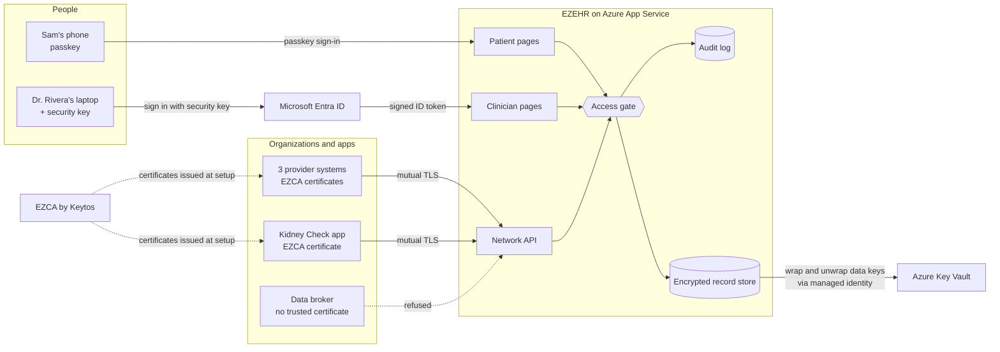

**What EZEHR trusts, and nothing else:**
1. **Microsoft Entra ID**, but only for the tenants listed in `TrustedTenants` (for the demo, our tenant, which plays Riverside Primary Care).
2. **The EZCA root CA**, whose public certificate is committed in `Security/Trust/`.
3. **Its own passkey table**, for patients.

---

## 3. Every party at a glance

| Party | Identity on the platform (`Party.SubjectUri`) | Credential | Where the private key lives | Who vouches | What our code checks |
|---|---|---|---|---|---|
| **Sam (patient)** | patient ID (GUID) | Passkey | The phone's secure hardware; it never leaves | Nobody else; our server stored Sam's public key at enrollment | WebAuthn signature against the stored public key |
| **Dr. Rivera (clinician)** | `urn:entra:{tenantId}:{objectId}` | Security key (FIDO2) used for **Entra** sign-in | Inside the security key | **Microsoft Entra** signs the ID token | Token signature, issuer, and audience (library); tenant trusted; app role `Clinician`; session under 10 h |
| **Lakeside, Northwind, Maple (providers)** | `urn:provider:lakeside` and so on | EZCA client certificate (CN `lakeside.providers.ezehr`) | `.pki/lakeside.pfx` on the simulator's machine | **EZCA** | Chain to the EZCA root; not expired; Client Authentication usage; CN in `OrgDirectory` |
| **Kidney Check (app)** | `urn:app:kidney-check` | EZCA client certificate (CN `kidney-check.apps.ezehr`) | `.pki/kidney-check.pfx` | **EZCA**, plus Sam's grant | The same certificate checks, plus a `LabsAndNotes` grant from Sam |
| **EZEHR platform** | `urn:platform:ezehr` | EZCA certificate (CN `platform.ezehr`), used only to **sign** clinician notes | Key Vault secret `platform-cert`, loaded by App Service | **EZCA** | Anyone can verify the signature against the EZCA root |
| **Data broker** | none | No certificate, or a self-made one | Its own machine | Nobody | Fails the certificate checks, so `UnverifiedCaller` and refused |
| **EZEHR server → Azure** | App Service **managed identity** | Azure-issued token, automatic | Azure manages it; we store no secret | Azure | Key Vault roles: Crypto User (wrap and unwrap), Secrets User (read the platform certificate) |

---

## 4. Setup-time flows (done once, before the demo)

### 4a. Issuing certificates with EZCA

The private keys are created on the identity lead's laptop. EZCA only sees **certificate requests** (CSRs), which contain the public key and are signed by the private key to prove possession. EZCA signs the certificate; it never sees a private key.

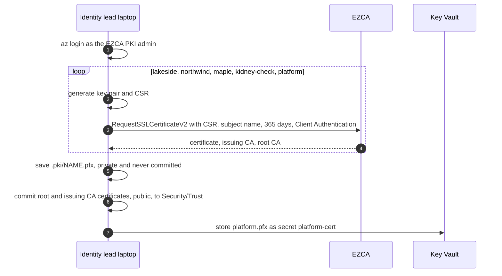

The broker's certificate is made by the same tool **without EZCA** (`certs broker`), on purpose.

### 4b. Entra setup (portal)

- **App registration "EZEHR":**
  - single tenant, platform **Web**, ID tokens on, no client secret
  - redirect URI `/signin-oidc`
  - app role **Clinician**, assigned to Dr. Rivera
- **Dr. Rivera's sign-in methods:** passkey (FIDO2) enabled, and **the physical security key registered** as Dr. Rivera's passkey.
- **EZEHR's config:** `TrustedTenants = { tenantId: "Riverside Primary Care" }`. This is how a tenant ID turns into an organization name.

### 4c. Azure plumbing

- App Service has a **system-assigned managed identity**. Key Vault grants it:
  - **Key Vault Crypto User** on `records-kek`, to wrap and unwrap patients' data keys
  - **Key Vault Secrets User**, to read `platform-cert`
- App Service **client certificates = "Optional Interactive User"**:
  - browsers aren't asked for a certificate
  - programs (our tools) can present one
  - App Service passes it to our code in the `X-ARR-ClientCert` header
  - **App Service does not validate it; our code does**

---

## 5. Runtime flows

### Flow 1: Patient enrollment (invite → passkey)

A provider creates an invite, like a patient-portal activation code. Sam opens it on a phone and creates a passkey. Nothing is shared with anyone yet, apart from the optional Kidney Check grant if Sam ticks the box.

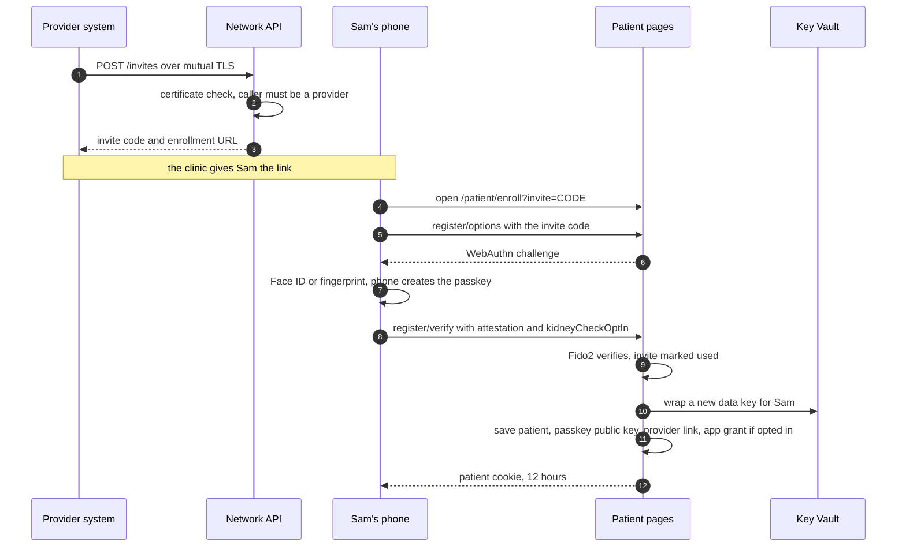

**Proven:** the person holding this phone is the person the provider invited. **Stored:** only the passkey's *public* key.

### Flow 2: Patient sign-in

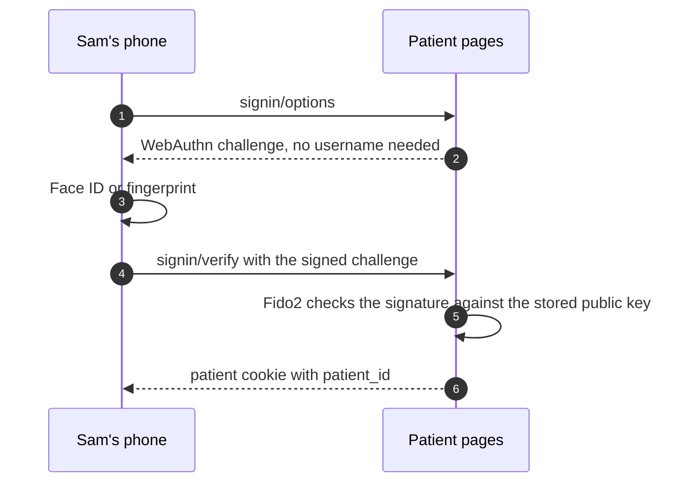

### Flow 3: Clinician sign-in (Entra + security key)

**Our app never talks to the security key.** Microsoft does. Our app only checks Microsoft's signed token, then applies its own rules.

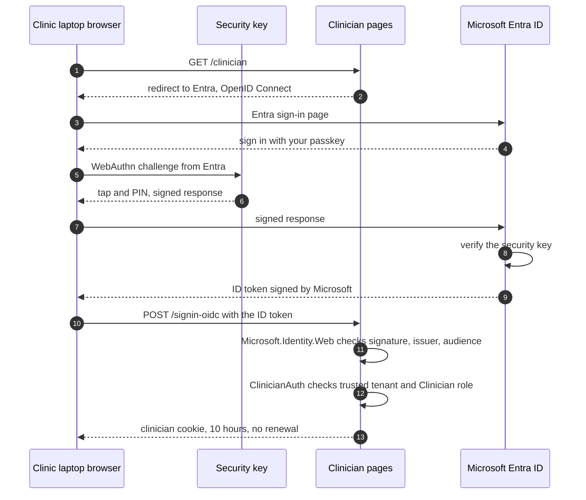

**Proven:** Microsoft vouches that this is Dr. Rivera from the Riverside tenant, signed in with a phishing-resistant key, and holding the Clinician role.

**Not yet proven:** that Dr. Rivera may see Sam's record. That is Flow 5.

### Flow 4: A provider pushes records (mutual TLS + signed records)

Two separate proofs are at work:
- **The TLS client certificate** proves *who is connected right now*.
- **The signature on each record** proves *who wrote this record*, and keeps proving it later, in exports and in other systems.

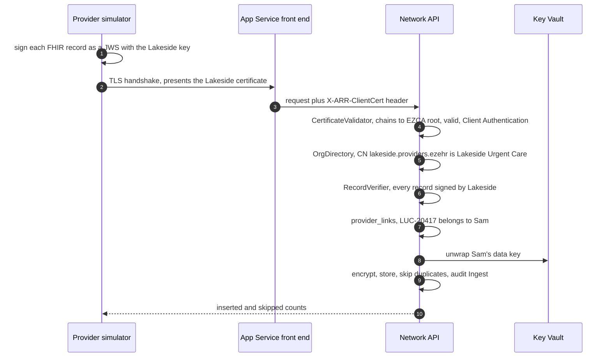

### Flow 5: Sharing with a clinician (code → approval → grant)

A grant is the only thing that lets a signed-in clinician into a record. Sam creates it, and it is bound to one verified identity.

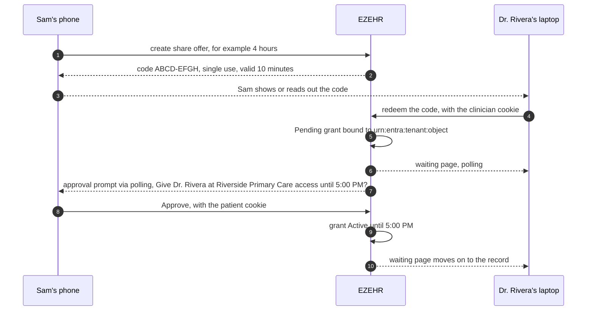

The name in the prompt comes from **Microsoft's token**, not from anything the doctor typed. A photo of the code doesn't help anyone else: the code works once, and Sam sees exactly who redeemed it.

### Flow 6: The clinician reads the record (and writes a note)

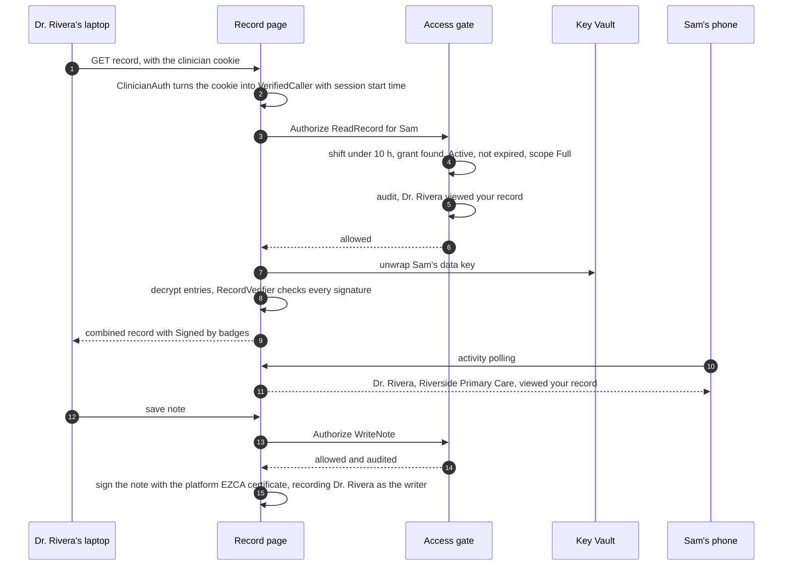

Every page load repeats the gate check. That's how revocation and expiry take effect immediately (Flow 9).

### Flow 7: The Kidney Check app (an app on the open platform)

The app is just another organization at the network door. What makes it special is its **narrow grant**: lab results only, plus permission to post notes.

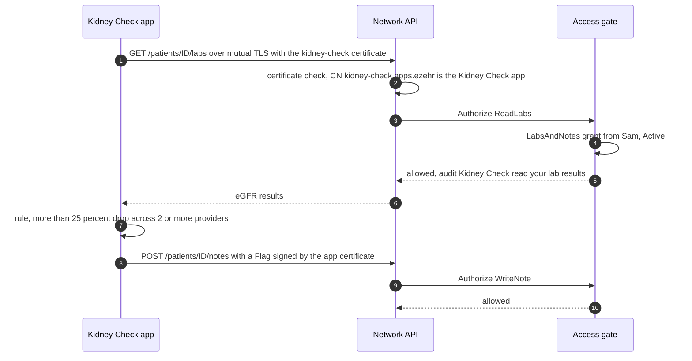

If the app tries `GET /patients/ID/record` (everything), the gate answers `ScopeDenied`. If Sam revokes the grant, the next call gets `GrantRevoked`.

### Flow 8: The data broker is refused (the Particle moment)

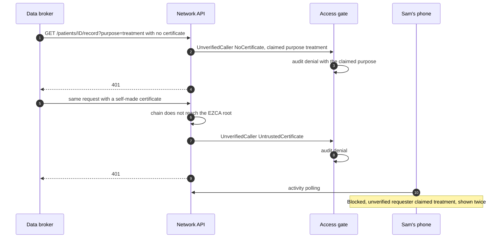

The broker **claims** "treatment", just as the companies did in the Particle–Epic dispute. EZEHR records the claim but ignores it: a purpose isn't a credential.

### Flow 9: How access ends

| Event | What happens on the next request | Patient sees |
|---|---|---|
| Sam taps **Revoke** | Gate: `GrantRevoked`. The clinician is sent to "access ended" | The denied attempt, if the clinician tries again |
| The grant reaches its **end time** | Gate marks it `Expired`, then `GrantExpired` | The same |
| The clinician's **10-hour shift** ends | Cookie expired (sign in again with the key); the gate also checks `ShiftEnded` | n/a |
| Sam revokes **Kidney Check** | The app gets 403 `GrantRevoked` | The denial in activity |

Expiry stops **future** reads. It can't erase what someone already saw, which is why every read is logged.

---

## 6. How the components fit together

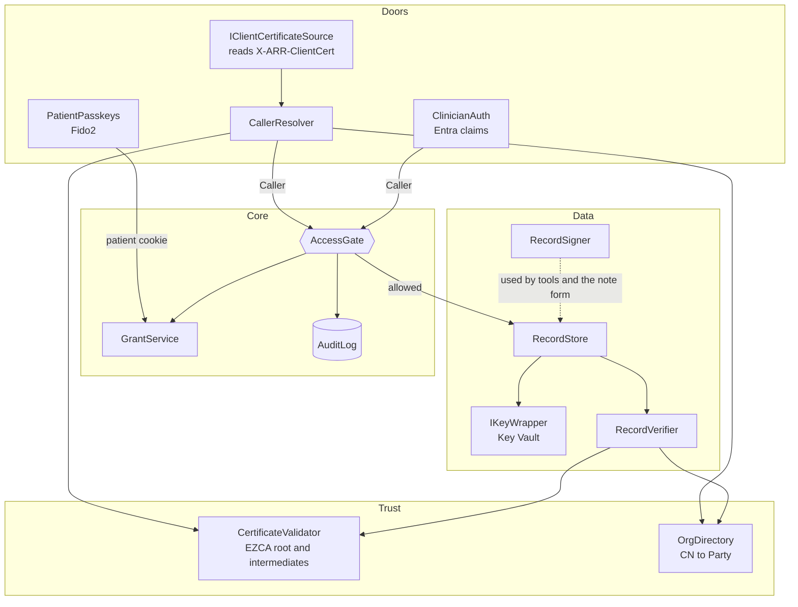

| Component | Called by | Takes | Gives back |
|---|---|---|---|
| `IClientCertificateSource` | Network API | the HTTP request | the caller's certificate, or nothing |
| `CertificateValidator` | `CallerResolver`, `RecordVerifier` | a certificate (+ chain) and a time | OK, `UntrustedCertificate`, or `CertificateExpired` (2-minute clock-skew tolerance) |
| `OrgDirectory` | `CallerResolver`, `RecordVerifier` | the certificate's CN | a `Party` (provider, app, or platform), or nothing |
| `CallerResolver` | Network API | a certificate or nothing | `VerifiedCaller(party)` or `UnverifiedCaller(reason)` |
| `PatientPasskeys` | patient pages | WebAuthn responses | a patient cookie (`patient_id`) |
| `ClinicianAuth` | clinician pages | Entra claims from the cookie | `VerifiedCaller(clinician, sessionStartedAt)`, or the `NotAClinician` / `UntrustedOrg` message |
| `GrantService` | patient pages, clinician pages, gate | offers, redemptions, approvals, revocations | grants |
| **`AccessGate`** | **every read and write** | patient, action, `Caller`, claimed purpose | allowed + grant, or a `DenyReason`. **Always exactly one audit event** |
| `AuditLog` | gate; patient activity page | events | the patient's activity list |
| `RecordStore` | only code that the gate has allowed, plus the patient's own pages | patient ID | decrypted signed entries; unwraps the key through Key Vault on every call |
| `IKeyWrapper` | `RecordStore` | a patient data key | the wrapped or unwrapped key (Key Vault, `RSA-OAEP-256`) |
| `RecordSigner` | tools; the clinician note form (platform certificate) | a FHIR resource and a certificate with its key | a JWS with the certificate attached |
| `RecordVerifier` | ingest, reads, export | a JWS | `VerifiedEntry` with the signer `Party` and the signing time |
| `ICertificateAuthority` (`EzcaCa`, `LocalCa`) | **only the `certs` tool** (setup time) | a CSR and a subject name | a certificate and chain |

---

## 7. What each mechanism proves (and what it doesn't)

| Mechanism | Proves | Does **not** prove |
|---|---|---|
| HTTPS server certificate (`*.azurewebsites.net`) | You're talking to the real EZEHR site | Anything about the client |
| Patient passkey | The same person who enrolled with that provider invite is back | Their legal identity (identity proofing is a stretch goal) |
| Entra ID token + security key | Microsoft vouches: this is Dr. Rivera from a trusted tenant, holding the Clinician role, signed in with a phishing-resistant key | That Sam agreed to share; that comes from the grant |
| Clinician cookie | That sign-in happened within this 10-hour shift | That it hasn't been stolen; it's limited by HttpOnly, same-site, and the 10-hour cap |
| EZCA client certificate (mutual TLS) | EZCA vouches that this connection is Lakeside's (or the app's) system | That the organization may read Sam's data; that comes from links and grants |
| Record signature (JWS) | This exact record was written by Lakeside (or the app, or EZEHR for a clinician), and hasn't changed since | That its medical content is correct |
| Grant | Sam agreed: this party, this scope, until this time | Anything after it's revoked or expired |
| Audit event | That an attempt happened, by whom, with what outcome and claimed purpose | Nothing beyond that; it's evidence, not prevention |
| Key Vault envelope encryption | Data at rest is unreadable without EZEHR's managed identity calling Key Vault | That EZEHR itself can't read it (it can, behind the gate; see the spec's honest limits) |

---

## 8. Denial reference

| `DenyReason` | Where it comes from | HTTP or page | Logged to the patient? |
|---|---|---|---|
| `NoCertificate` | Network door: nothing presented | 401 | Yes, when the request targets a patient |
| `UntrustedCertificate` | Network door: chain doesn't reach EZCA, or the CN isn't in `OrgDirectory` | 401 | Yes, when the request targets a patient |
| `CertificateExpired` | Network door, or record verification | 401 / record rejected | Yes, when the request targets a patient |
| `ShiftEnded` | Gate: clinician session over 10 h | "Sign in again" page | Yes |
| `NoGrant` | Gate: no grant for this identity | "Access ended" page / 403 | Yes |
| `GrantPending` | Gate: Sam hasn't approved yet | Waiting page / 403 | Yes |
| `GrantRevoked` / `GrantExpired` | Gate | "Access ended" page / 403 | Yes |
| `ScopeDenied` | Gate: an app asked for more than lab results | 403 | Yes |

---

## 9. Glossary

- **Passkey / FIDO2 / WebAuthn:** a sign-in method where the device holds a private key and signs a challenge. There's no password, and a passkey only works on the real site, so it can't be phished. A **security key** (for example a YubiKey) is a passkey on dedicated hardware.
- **OpenID Connect (OIDC):** the standard way a website asks Microsoft Entra to sign someone in. Entra returns a signed **ID token** saying who they are.
- **App role:** a label (here, `Clinician`) that Entra puts in the token for users the tenant admin assigned to it.
- **X.509 certificate:** a public key plus identity details, signed by a certificate authority (CA). **EZCA** is ours.
- **Chain / root:** our server trusts the EZCA root. A certificate is trusted if it traces back to that root through EZCA's issuing CA.
- **CSR:** a certificate signing request: the public key plus requested details, signed by the private key. The CA signs it into a certificate without seeing the private key.
- **Mutual TLS:** normal HTTPS where the *client* also presents a certificate during the handshake.
- **JWS:** a standard signed-data format (RFC 7515). Our records are JWS with the signer's certificate attached (the `x5c` header).
- **Envelope encryption:** each patient's records are encrypted with that patient's own data key, and that key is stored only in wrapped (encrypted) form by a Key Vault key that never leaves Key Vault.
- **Managed identity:** an identity Azure gives our App Service automatically, so it can call Key Vault without any stored password or secret.
