# EZEHR Authentication and Trust Flows

This document explains, party by party, **how everyone proves who they are**, which component checks it, and how those components hand results to each other. It complements the spec (`docs/superpowers/specs/2026-11-13-hackathon-design.md`) and the build plan (`docs/superpowers/plans/2026-11-13-verified-health-record.md`). The diagrams are Mermaid, which GitHub draws automatically.

---

## 1. The one idea to hold onto

EZEHR has **three front doors**, one for each kind of party. Each door checks a different kind of credential, but **every door produces the same thing: a `Caller`**. Behind the doors sits **one access gate**, which only understands a `Caller`, a patient's **grant**, and the action being attempted. It decides yes or no, and it always writes exactly one audit event.

| Door | Who comes through it | Credential | Checked by | Result |
|---|---|---|---|---|
| **Patient pages** (`/patient/*`) | Sam, on a phone | **Passkey** on the phone | Our server (Fido2 library) | A patient cookie session (`patient_id`) |
| **Clinician pages** (`/clinician/*`) | Dr. Rivera, on a laptop, arriving from a **launch** made by Riverside's system | **Security key**, used to sign in to **Microsoft Entra ID** | Entra checks the key. Our server checks Entra's signed **ID token**, and that the launch was made for this clinician | A clinician cookie session, fixed at 10 hours, which becomes `VerifiedCaller(clinician)`, plus an open launch naming the chart and the visit |
| **Network API** (`/api/network/*`) | Provider systems, the Kidney Check app, and the data broker | **EZCA client certificate**, presented in the TLS handshake (**mutual TLS**) | Our server checks that the certificate chains to the EZCA root and maps it to a known organization | `VerifiedCaller(provider or app)`, or `UnverifiedCaller(reason)` |

A sign-in only proves **who** someone is. Whether they may read Sam's record is a separate question, answered by **Sam's grant**. Even a perfectly signed-in doctor gets nothing until Sam approves.

### Who writes, who reads

**People read; organizations write, and sign what they write.**

| | Reads | Writes |
|---|---|---|
| **Clinician** (clinician pages) | the combined record, under Sam's grant | **nothing** |
| **Provider system** (network API) | nothing | records for its own linked patients, each signed with its EZCA key. The patient sees these links under "Connected clinics" on the Access page and can disconnect one; linking again takes a new invite |
| **App** (network API) | what its grant allows (Kidney Check: lab results) | signed notes, if its grant allows |

This mirrors how care is really documented. A clinician charts in **their own organization's system**, which is the legal custodian of that record: history taken at the visit, diagnoses, medication changes, referrals. That system then pushes the result to EZEHR like any other provider. So Dr. Rivera's plan and the nephrology referral reach Sam's record from **Riverside's** system, signed by Riverside, with Dr. Rivera as author. The clinician pages exist for the gap no single system can fill: seeing what *other* organizations hold, with the patient's consent.

The two doors meet in the **launch** (Flow 13): a clinician can ask for a record only after their own organization's system, with its certificate, has opened EZEHR for them from one patient's chart for one visit. So the organization takes part in every access, and can refuse by not launching. The shape is borrowed from a SMART on FHIR EHR launch; `docs/direction.md` says what real integration would take beyond this.

---

## 2. The big picture


**What EZEHR trusts, and nothing else:**
1. **Microsoft Entra ID**, but only for tenants that a provider's row in the `organizations` table names (for the demo, our tenant, set on Riverside Primary Care's row).
2. **The network's root CA**, whose public certificate is committed in `Security/Trust/`, and only for certificate CNs that have a row in `organizations`. This was EZCA during the hackathon; since its subscription ended it is the local test CA ("EZEHR Local Root", `certs issue --ca local`, the default), which stands in for EZCA in every flow below. See `docs/ezca-notes.md`.
3. **Its own passkey table**, for patients.

---

## 3. Every party at a glance

| Party | Identity on the platform (`Party.SubjectUri`) | Credential | Where the private key lives | Who vouches | What our code checks |
|---|---|---|---|---|---|
| **Sam (patient)** | patient ID (GUID) | Passkey | The phone's secure hardware; it never leaves | Nobody else; our server stored Sam's public key at enrollment | WebAuthn signature against the stored public key |
| **Dr. Rivera (clinician)** | `urn:entra:{tenantId}:{objectId}` | Security key (FIDO2) used for **Entra** sign-in | Inside the security key | **Microsoft Entra** signs the ID token | Token signature, issuer, and audience (library); tenant trusted; app role `Clinician`; session under 10 h |
| **Lakeside, Northwind, Maple, Riverside (providers)** | `urn:provider:lakeside` and so on | EZCA client certificate (CN `lakeside.providers.ezehr`) | `.pki/lakeside.pfx` on the simulator's machine | **EZCA** | Chain to the EZCA root; not expired; Client Authentication usage; CN found in `organizations` |
| **Kidney Check (app)** | `urn:app:kidney-check` | EZCA client certificate (CN `kidney-check.apps.ezehr`) | `.pki/kidney-check.pfx` | **EZCA**, plus Sam's grant | The same certificate checks, plus a `LabsAndNotes` grant from Sam |
| **Data broker** | none | No certificate, or a self-made one | Its own machine | Nobody | Fails the certificate checks, so `UnverifiedCaller` and refused |
| **EZEHR server → Azure** | App Service **managed identity** | Azure-issued token, automatic | Azure manages it; we store no secret | Azure | Key Vault role: Crypto User (wrap and unwrap). Azure SQL: a database user that can read, write and create tables |

---

## 4. Setup-time flows (done once, before the demo)

### 4a. Issuing certificates with EZCA

The private keys are created on the identity lead's laptop. EZCA only sees **certificate requests** (CSRs), which contain the public key and are signed by the private key to prove possession. EZCA signs the certificate; it never sees a private key.

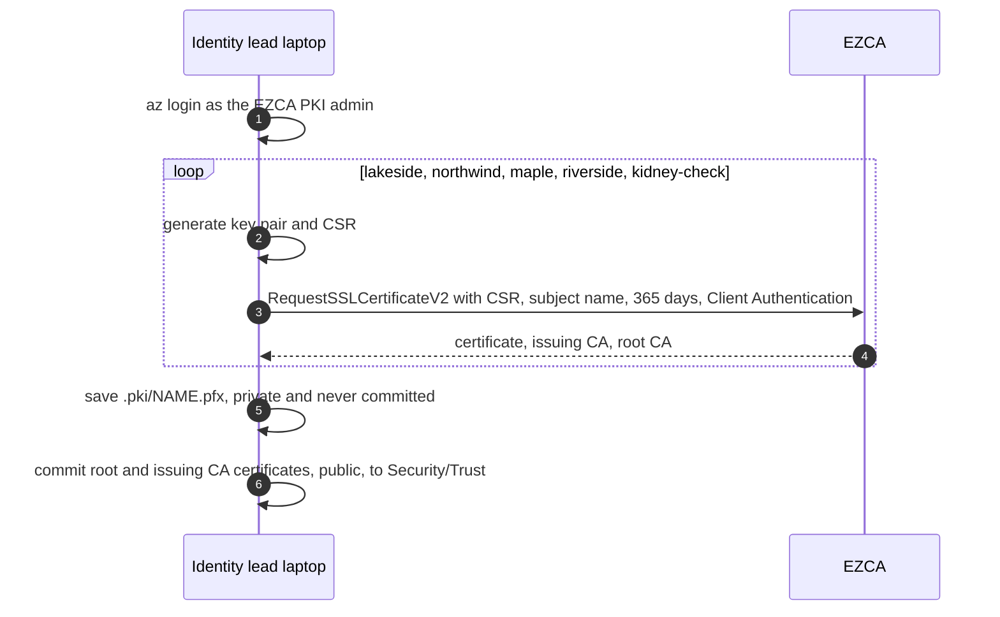

The broker's certificate is made by the same tool **without EZCA** (`certs broker`), on purpose.

With the local test CA (the default now), the laptop is the CA: `certs issue` signs each CSR with `.pki/local-root.pfx` instead of calling EZCA, and the root certificate (no issuing CA) goes to `Security/Trust/`.

### 4b. Entra setup (portal)

- **App registration "EZEHR":**
  - single tenant, platform **Web**, ID tokens on, no client secret
  - redirect URI `/signin-oidc`
  - app role **Clinician**, assigned to Dr. Rivera
- **Dr. Rivera's sign-in methods:** passkey (FIDO2) enabled, and **the physical security key registered** as Dr. Rivera's passkey.
- **EZEHR's organizations table:** Riverside's row carries the tenant id. This is how a tenant id turns into a provider identity; the organization's name comes from the same row. A sysadmin sets it once per environment:

  ```sql
  UPDATE organizations SET entra_tenant_id = '<tenant id>' WHERE uri = 'urn:provider:riverside';
  ```

### 4b-2. The organizations table

`organizations` is the one list of who each organization is: `uri` (its identity on the platform), `kind` (`Provider` or `App`), `display_name`, `certificate_cn` (the CN on its EZCA certificate, compared without case), `entra_tenant_id` (providers only; a tenant belongs to at most one provider), and for apps `app_scope` (the most a patient can allow it: `LabsAndNotes` or `MedicationsLabsAndNotes`) and `app_description` (what the patient reads before turning it on). The server reads it on every request that needs it, so an edit takes effect immediately.

- A new database starts with the six demo organizations (four providers, Kidney Check and Medication Check): the app seeds them when the table is empty. Once the table has any rows the app never touches it, so a sysadmin's edits and deletions survive restarts, and `ezehr-tools demo reset` leaves the table alone.
- **Cutting off an organization** (for example, a leaked key): delete its row. EZEHR doesn't check certificate revocation, so this is the kill switch, and it takes effect on the next request. Its certificate is then refused at the network door, its clinicians can't sign in, and records it signed no longer verify, so they drop out of every view until the row is restored.
- **Adding a provider** goes through `POST /api/network/register-provider` (Flow 11). Only the platform operator can call it, using the platform certificate. `ezehr-tools certs issue --provider` registers the name on EZCA, issues the certificate and calls the endpoint in one run. **Adding an app** goes through `POST /api/network/register-app` the same way: `ezehr-tools certs issue --app <slug> --name "<name>" --scope <scope> --description "<text>"`. A registered app has no access to anyone: each patient sees it on their Access page, off, and decides. Entra tenants are still set by hand (4b).
- The tools have no database. Their directory is the demo list in `OrgDirectory`, plus every provider `certs issue --provider` onboarded, which is saved in `.pki/organizations.json` (`ToolOrganizations`).

**Deployment note (moving off `App:TrustedTenants`):** before deploying, copy the tenant id out of the App Service setting `App__TrustedTenants__…` (the id is in the setting's name, with underscores where the hyphens go). Once the deployed app has started and seeded the table, run the `UPDATE` above against prod, then delete the old setting. Dr. Rivera is refused between the deploy and the `UPDATE`.

### 4c. Azure plumbing

- App Service has a **system-assigned managed identity**. Key Vault grants it:
  - **Key Vault Crypto User** on `records-kek`, to wrap and unwrap patients' data keys. The server holds no certificate of its own and needs no other secret.
- Azure SQL uses **Entra-only authentication**. The same managed identity is a database user (`db_datareader`, `db_datawriter`, `db_ddladmin`), so the connection string holds no password.
- App Service **client certificates = "Optional Interactive User"**:
  - browsers aren't asked for a certificate
  - programs (our tools) can present one
  - App Service passes it to our code in the `X-ARR-ClientCert` header
  - **App Service does not validate it; our code does**

### 4d. The NUC (replaces Azure, whose subscription is cancelled)

`scripts/nuc-setup.sh` runs the same app on a home server at `https://colin-nuc.tail51bf60.ts.net`, open to the internet.

- **Tailscale Funnel in raw TCP mode** (`tailscale funnel --tcp 443`) carries internet and tailnet traffic to Kestrel on `127.0.0.1:8443` *without decrypting it*. Kestrel terminates TLS itself, with a `tailscale cert` (Let's Encrypt) certificate, so the client certificate arrives on the TLS connection and `ClientCertificateHeader` stays unset. Funnel's default HTTPS mode, or Cloudflare Tunnel, would end TLS at the proxy and the network door would never see a certificate.
- **Every caller reaches Kestrel from `127.0.0.1`**, so the network door's per-address rate limit (120 calls a minute) is one bucket shared by everyone. Fine for the demo; Funnel's `--proxy-protocol` could carry the real address if Kestrel learned to read it.
- **Deploys:** every push to `main` that builds and passes the tests is deployed by `.github/workflows/deploy.yml`. The job joins the tailnet as a temporary `tag:ezehr-ci` device (Tailscale trusts GitHub's OIDC token for this repo's `nuc` environment, so no Tailscale secret is stored; since the transfer the token's subject is GitHub's immutable form, `repo:colinmeyer0@195044984/EZEHR@1457042078:environment:nuc`, and the trust credential must name exactly that) and SSHes to the NUC with a deploy key. That key's forced command, `scripts/nuc-deploy.sh`, only fast-forwards the checkout to a commit already on `main` and runs `nuc-setup.sh`.
- **Key wrapping is local** (`App__KeyWrapper__Mode=Local`): the key that wraps patients' data keys is in `/etc/ezehr/secrets.env` on the NUC, not Key Vault. SQL Server runs in docker on `127.0.0.1`; `tailscale serve --tcp 1433` exposes it to the tailnet only, for the laptop's tools.

---

## 5. Runtime flows

### Flow 1: Patient enrollment (invite → passkey)

A provider creates an invite, like a patient-portal activation code. Sam opens it on a phone and creates a passkey. Nothing is shared with anyone yet, apart from the optional Kidney Check grant if Sam ticks the box.

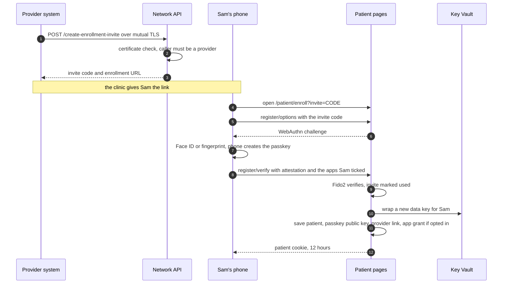

**Proven:** the person holding this phone is the person the provider invited. **Stored:** only the passkey's *public* key.

### Flow 2: Patient sign-in

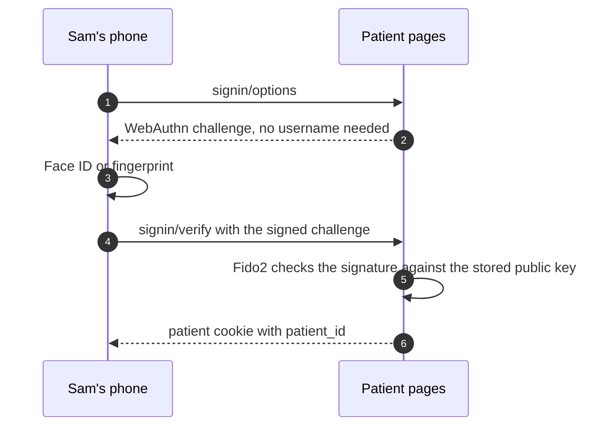

### Flow 3: Clinician sign-in (Entra + security key)

**Our app never talks to the security key.** Microsoft does. Our app only checks Microsoft's signed token, then applies its own rules.


**Proven:** Microsoft vouches that this is Dr. Rivera from the Riverside tenant, signed in just now, and holding the Clinician role. `prompt=login` makes Entra ask again on every sign-in, so signing out of EZEHR, or the end of the 10-hour shift, really ends access, and the key tap happens each time.

**What makes it the security key:** our app doesn't check *how* Dr. Rivera authenticated (v2 ID tokens carry no `amr`). Entra enforces it: a Conditional Access policy requiring the "phishing-resistant MFA" authentication strength for the EZEHR app. Without that policy, a password sign-in is accepted.

**Not yet proven:** that Dr. Rivera may see Sam's record. That is Flow 5.

### Flow 4: A provider pushes records (mutual TLS + signed records)

Riverside's system uses this same flow after the visit to push Dr. Rivera's plan and referral (see section 1, "Who writes, who reads").

Two separate proofs are at work:
- **The TLS client certificate** proves *who is connected right now*.
- **The signature on each record** proves *who wrote this record*, and keeps proving it later, in exports and in other systems.

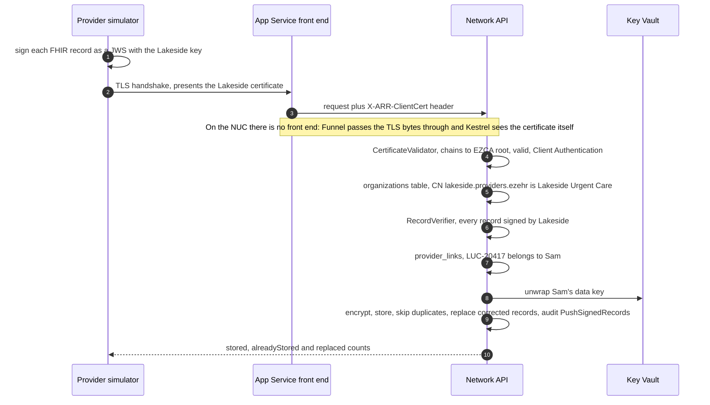

### Flow 5: Sharing with a clinician (code → approval → grant)

A grant is the only thing that lets a signed-in clinician into a record. Sam creates it, and it is bound to one verified identity. Dr. Rivera reaches the share-code form only through a launch from Riverside's system (Flow 13), and the code must be Sam's: the launch names Riverside's chart for Sam, and EZEHR checks that the code's patient is linked to Riverside under that id.

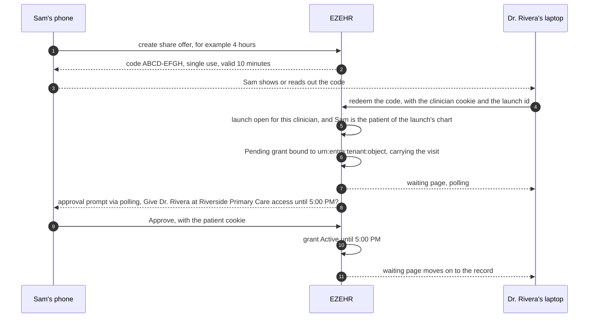

The name in the prompt comes from **Microsoft's token**, not from anything the doctor typed. A photo of the code doesn't help anyone else: the code works once, and Sam sees exactly who redeemed it.

### Flow 6: The clinician reads the record

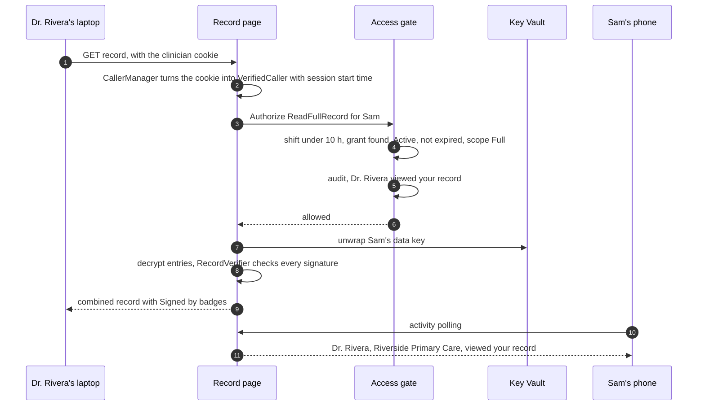

The clinician pages are read-only. A clinician grant (scope `Full`) allows `ReadFullRecord` and `ReadEgfrLabs`, and the gate answers `ScopeDenied` to any write. Dr. Rivera documents the visit in Riverside's own system, which pushes it through Flow 4.

Every page load repeats the gate check. That's how revocation and expiry take effect immediately (Flow 9).

### Flow 7: The Kidney Check app (an app on the open platform)

The app is just another organization at the network door. What makes it special is its **narrow grant**: lab results only, plus permission to post notes.

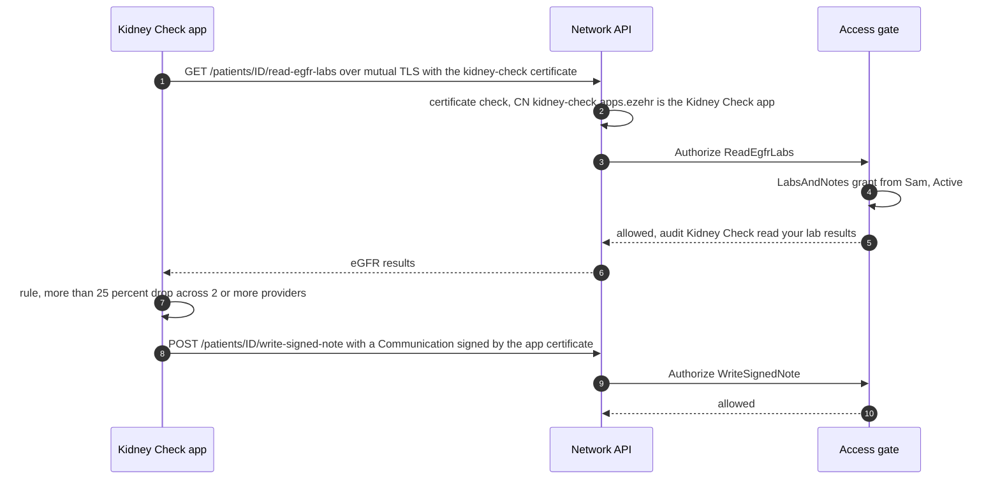

If the app tries `GET /patients/ID/read-full-record` (everything), the gate answers `ScopeDenied`. If Sam revokes the grant, the next call gets `GrantRevoked`.

**More than one app.** Apps are rows in `organizations`, and each declares a scope. Sam's Access page lists every app with what it does and what it could read, each off until Sam turns it on. **Medication Check** is the second example: its scope, `MedicationsLabsAndNotes`, also allows `GET /patients/ID/read-medications`, and it notes when Sam takes an anti-inflammatory painkiller while eGFR is falling. Kidney Check calling `read-medications` gets `ScopeDenied`, because its grant is `LabsAndNotes`. The design is in `docs/superpowers/specs/2026-11-17-app-platform-design.md`.

### Flow 8: The data broker is refused (the Particle moment)

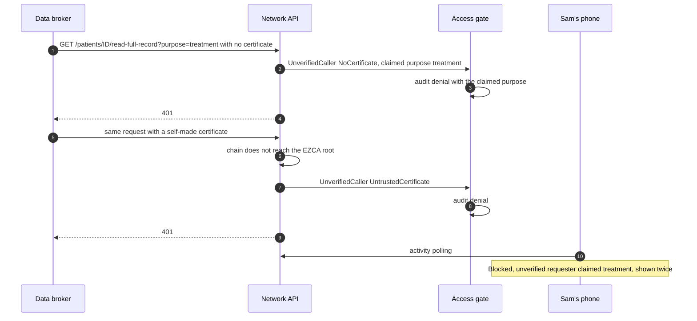

The broker **claims** "treatment", just as the companies did in the Particle–Epic dispute. EZEHR records the claim but ignores it: a purpose isn't a credential.

### Flow 9: How access ends

| Event | What happens on the next request | Patient sees |
|---|---|---|
| Sam taps **Revoke** | Gate: `GrantRevoked`. The clinician is sent to "access ended" | The denied attempt, if the clinician tries again |
| The grant reaches its **end time** | Gate marks it `Expired`, then `GrantExpired` | The same |
| The clinician's **10-hour shift** ends | Cookie expired (sign in again with the key); the gate also checks `ShiftEnded` | n/a |
| Sam revokes **Kidney Check** | The app gets 403 `GrantRevoked` | The denial in activity |

Expiry stops **future** reads. It can't erase what someone already saw, which is why every read is logged.

### Flow 10: A provider audits its clinicians

Riverside may need to review what its own clinicians did on EZEHR, the way a hospital audits chart access. Its system asks over the same network door it already uses, with its EZCA certificate.

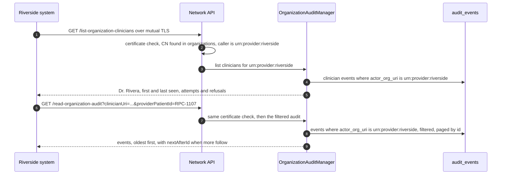

- **What it sees:** every attempt by someone it vouches for: its clinicians' reads and share-code redemptions, granted or refused, and its own system's calls (pushes, invites). Each audit row records the actor's organization (`actor_org_uri`) when the event happens, so a clinician who later leaves stays in the history of the organization they acted for.
- **What it never sees:** anything done by another organization, its clinicians, an app, or an unverified caller, even for the same patient.
- **How patients appear:** by EZEHR patient id, plus the provider's own patient id when the patient is linked to it (`provider_links`). No names.
- **Filters:** `clinicianUri`, `patientId`, `providerPatientId`, `since` (inclusive), `until` (exclusive), and paging by `afterId` with `limit` (1 to 500, default 100). `ezehr-tools provider audit <slug>` and `provider clinicians <slug>` call both endpoints.

### Flow 11: The platform onboards a new provider

A provider that has never existed, Harbor Clinic, joins on camera. No Entra tenant is involved, because Harbor's system only invites patients and pushes records. One command on the operator's laptop does all of it:

```
ezehr-tools certs issue --provider harbor --name "Harbor Clinic" --invite HBR-001
```

That uses the local test CA, so the two EZCA steps below happen on the laptop instead. With `--ca ezca` it goes through EZCA as drawn.

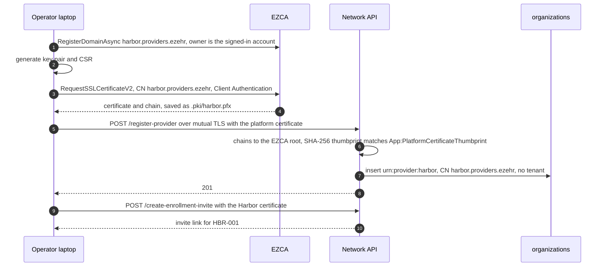

- **The platform certificate** is an ordinary certificate from the network's CA (CN `platform.ezehr`, from `certs issue --platform`). What makes it special is that the server pins its SHA-256 thumbprint in `App__PlatformCertificateThumbprint` (an App Service setting; on the NUC, `nuc-setup.sh` takes it from `appsettings.Development.json`). The platform isn't a `Party`: `CallerManager.FromPlatformCertificate` turns it into a `PlatformCaller`, which only `register-provider` accepts. Its CN has no row in `organizations`, so the network door refuses it everywhere else. If the setting is unset, nobody can register.
- **The slug** is one lowercase DNS label. The server builds `urn:provider:{slug}` and `{slug}.providers.ezehr` from it. An existing URI or CN gets 409 and the row stays unchanged, so running the command again is safe. Deleting the row is still the kill switch.
- Registration isn't written to `audit_events`, because those rows belong to a patient. It's logged instead.

---

### Flow 12: Emergency access (break-glass)

For when Sam can't tap Approve. It is **off unless Sam turned it on** from the Access page, which gives Sam an emergency code to keep on the phone's medical ID or a wallet card. The design is in `docs/superpowers/specs/2026-11-17-emergency-access-design.md`.

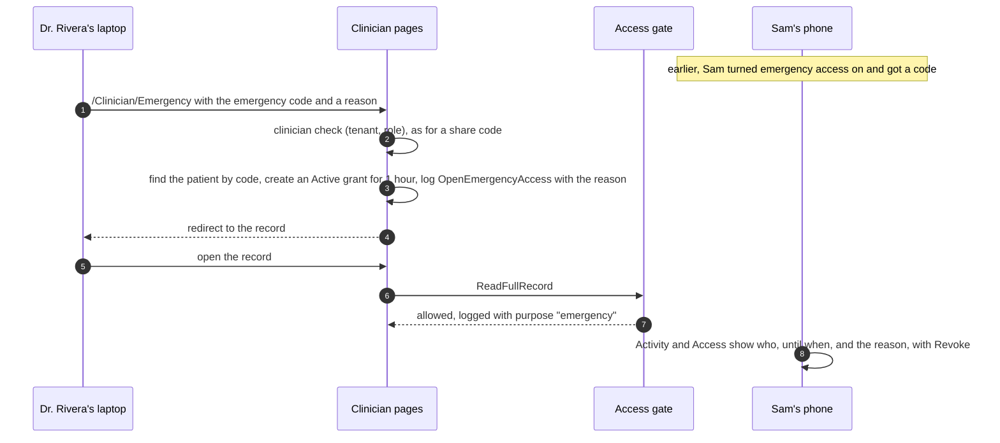

- **Still proven:** who the clinician is and which organization vouches for them. The emergency code replaces only Sam's live approval, never the sign-in.
- **Still needs a launch** (Flow 13), so the clinician's organization is part of it and the visit is recorded. The chart isn't matched to Sam, who may never have been to that organization.
- **What Sam sees:** a highlighted Activity line, "Emergency access: Dr. Rivera, Riverside Primary Care, opened your record without your approval. Reason given: …", and the grant on the Access page with a Revoke button.
- **What Riverside sees:** the same `OpenEmergencyAccess` event and its reason in its organization audit (Flow 10).
- **A wrong code** names no patient, so there is nobody to log it to.

---

### Flow 13: The organization launch

How a clinician's organization takes part in each access. The design is in `docs/superpowers/specs/2026-11-17-organization-launch-design.md`.

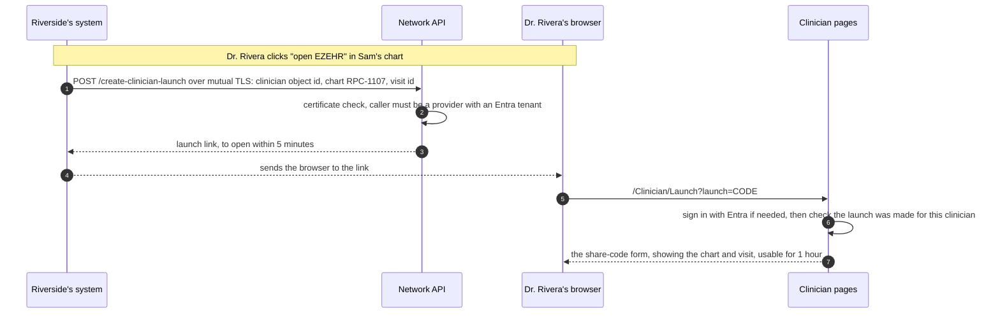

- **Proven:** Riverside, by its certificate, says this clinician of its own is seeing this patient of its own in this visit. The clinician URI is built from the tenant on Riverside's row, so a provider can't launch anyone else's clinician.
- **Checked later:** when Dr. Rivera enters a share code, its patient must be linked to Riverside under the launch's chart id. A code from another patient is refused with `OfferNotForLaunchedPatient`, stays unused, and shows on that patient's Activity as blocked.
- **Recorded:** the visit id goes on the grant and on every audit event decided under it, and Riverside's organization audit returns it.
- **Without a launch:** a signed-in clinician can open records they already have access to, and nothing else.
- `ezehr-tools provider launch riverside RPC-1107 --clinician <object id>` plays Riverside's system.

---

## 6. How the components fit together

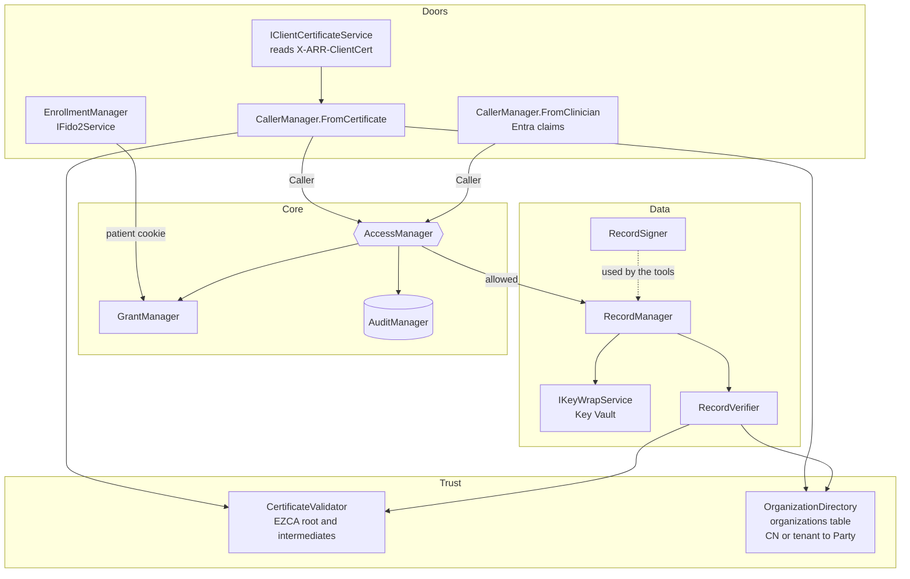

| Component | Called by | Takes | Gives back |
|---|---|---|---|
| `IClientCertificateService` | `NetworkController` | the HTTP request | the caller's certificate, or nothing |
| `CertificateValidator` | `CallerManager`, `RecordVerifier` | a certificate (+ chain) and a time | OK, `UntrustedCertificate`, or `CertificateExpired` (2-minute clock-skew tolerance) |
| `OrganizationManager` / `OrganizationDirectory` | `CallerManager`, `RecordManager` (for `RecordVerifier`), `EnrollmentManager` | the `organizations` table; then a certificate's CN, a platform URI or an Entra tenant id | a `Party` (provider or app), or nothing |
| `CallerManager.FromCertificateAsync` | `NetworkController` | a certificate or nothing | `VerifiedCaller(party)` or `UnverifiedCaller(reason)` |
| `EnrollmentManager` | patient pages, `PatientPasskeyController` | WebAuthn responses | a patient cookie (`patient_id`) |
| `CallerManager.FromClinicianAsync` | clinician pages | Entra claims from the cookie; the tenant is looked up in `organizations` | `VerifiedCaller(clinician, sessionStartedAt)`, or the `NotAClinician` / `UntrustedOrg` message |
| `GrantManager` | patient pages, clinician pages, gate | offers, redemptions, approvals, revocations | grants |
| **`AccessManager`** | **every read and write** | patient, action, `Caller`, claimed purpose | allowed + grant, or a `DenyReason`. **Always exactly one audit event** |
| `AuditManager` | gate; patient activity page | events | the patient's activity list |
| `OrganizationAuditManager` | `NetworkController` (`read-organization-audit`, `list-organization-clinicians`) | a `Caller` and a filter | the caller organization's own events or clinicians, or a `DenyReason` |
| `RecordManager` | `NetworkController`, clinician and patient pages | patient ID and `Caller` | verified signed entries, after asking the gate; unwraps the key through Key Vault on every call |
| `IKeyWrapService` | `RecordManager` | a patient data key | the wrapped or unwrapped key (Key Vault, `RSA-OAEP-256`) |
| `RecordSigner` | the tools (provider simulator, Kidney Check) | a FHIR resource and a certificate with its key | a JWS with the certificate attached |
| `RecordVerifier` | ingest, reads, export | a JWS | `VerifiedEntry` with the signer `Party` and the signing time |
| `ICertificateAuthorityService` (`EzcaCertificateAuthorityService`, `LocalCertificateAuthorityService`) | **only the `certs` tool** (setup and onboarding) | a CSR and a subject name; for EZCA, also a domain to register | a certificate and chain |
| `CallerManager.FromPlatformCertificate` | `NetworkController` (`register-provider`) | a certificate or nothing | `PlatformCaller` when it chains to EZCA and matches the pinned thumbprint, else `UnverifiedCaller` |
| `OrganizationManager.RegisterProviderAsync` | `NetworkController` | a `Caller`, a slug and a display name | the new `organizations` row, `OrganizationExists`, or a `DenyReason` |

---

## 7. What each mechanism proves (and what it doesn't)

| Mechanism | Proves | Does **not** prove |
|---|---|---|
| HTTPS server certificate (`*.azurewebsites.net`; on the NUC, Let's Encrypt for `colin-nuc.tail51bf60.ts.net`) | You're talking to the real EZEHR site | Anything about the client |
| Patient passkey | The same person who enrolled with that provider invite is back | Their legal identity (identity proofing is a stretch goal) |
| Entra ID token + security key | Microsoft vouches: this is Dr. Rivera from a trusted tenant, holding the Clinician role, signed in with a phishing-resistant key | That Sam agreed to share; that comes from the grant |
| Clinician cookie | That sign-in happened within this 10-hour shift | That it hasn't been stolen; it's limited by HttpOnly, same-site, and the 10-hour cap |
| EZCA client certificate (mutual TLS) | EZCA vouches that this connection is Lakeside's (or the app's) system | That the organization may read Sam's data; that comes from links and grants |
| Record signature (JWS) | This exact record was written by Lakeside (or the app; or Riverside, for a note authored by Dr. Rivera), and hasn't changed since | That its medical content is correct |
| Grant | Sam agreed: this party, this scope, until this time | Anything after it's revoked or expired |
| Launch | The clinician's organization, by its certificate, opened EZEHR for this clinician from this chart for this visit | That the visit id means anything outside the organization; that the organization still wants the access once the patient has approved it |
| Audit event | That an attempt happened, by whom, with what outcome and claimed purpose, and which organization vouched for the actor | Nothing beyond that; it's evidence, not prevention |
| Audit hash chain (each event's SHA-256 fingerprint covers the patient's previous event; the Activity page rechecks it on every load) | That no event was changed, removed from the middle or slipped in behind the app's back | That nobody rewrote the whole chain or cut off its newest events; only a fingerprint noted earlier shows that (see `docs/superpowers/specs/2026-11-17-audit-hash-chain-design.md`) |
| Key Vault envelope encryption | Data at rest is unreadable without EZEHR's managed identity calling Key Vault | That EZEHR itself can't read it (it can, behind the gate; see the spec's honest limits) |

---

## 8. Denial reference

| `DenyReason` | Where it comes from | HTTP or page | Logged to the patient? |
|---|---|---|---|
| `NoCertificate` | Network door: nothing presented | 401 | Yes, when the request targets a patient |
| `UntrustedCertificate` | Network door: chain doesn't reach EZCA, or the CN isn't in `organizations` | 401 | Yes, when the request targets a patient |
| `CertificateExpired` | Network door, or record verification | 401 / record rejected | Yes, when the request targets a patient |
| `ShiftEnded` | Gate: clinician session over 10 h | "Sign in again" page | Yes |
| `NoGrant` | Gate: no grant for this identity | "Access ended" page / 403 | Yes |
| `GrantPending` | Gate: Sam hasn't approved yet | Waiting page / 403 | Yes |
| `GrantRevoked` / `GrantExpired` | Gate | "Access ended" page / 403 | Yes |
| `LaunchPatientMismatch` | Share code used from a launch for another patient's chart | The form says so; the code stays unused | Yes |
| `ScopeDenied` | Gate: an app asked for more than its grant's scope, or a clinician tried to write | 403 | Yes |

---

## 9. Glossary

- **Passkey / FIDO2 / WebAuthn:** a sign-in method where the device holds a private key and signs a challenge. There's no password, and a passkey only works on the real site, so it can't be phished. A **security key** (for example a YubiKey) is a passkey on dedicated hardware.
- **OpenID Connect (OIDC):** the standard way a website asks Microsoft Entra to sign someone in. Entra returns a signed **ID token** saying who they are.
- **App role:** a label (here, `Clinician`) that Entra puts in the token for users the tenant admin assigned to it.
- **X.509 certificate:** a public key plus identity details, signed by a certificate authority (CA). **EZCA** is ours.
- **Chain / root:** our server trusts the EZCA root. A certificate is trusted if it traces back to that root through EZCA's issuing CA.
- **CSR:** a certificate signing request: the public key plus requested details, signed by the private key. The CA signs it into a certificate without seeing the private key.
- **Mutual TLS:** normal HTTPS where the *client* also presents a certificate during the handshake.
- **JWS:** a standard signed-data format (RFC 7515). Our records are JWS with the signer's certificate attached (the `x5c` header).
- **Envelope encryption:** each patient's records are encrypted with that patient's own data key, and that key is stored only in wrapped (encrypted) form by a Key Vault key that never leaves Key Vault.
- **Managed identity:** an identity Azure gives our App Service automatically, so it can call Key Vault without any stored password or secret.
